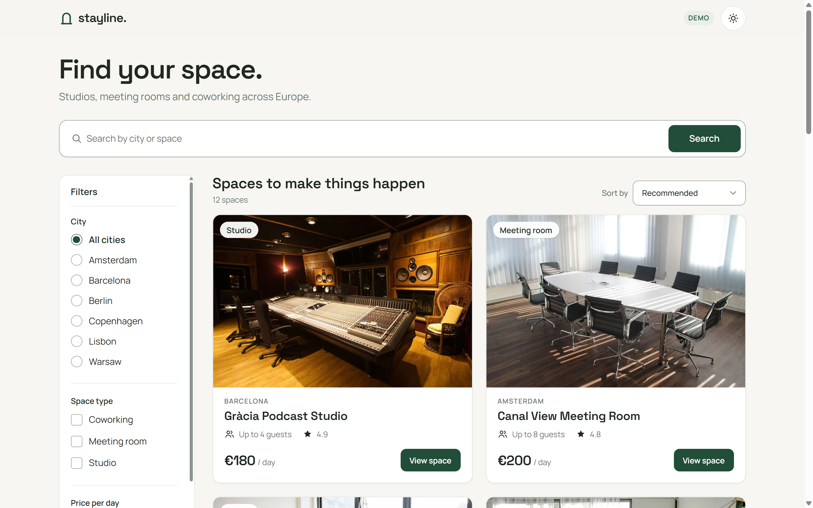

# Stayline

A booking interface for studios, coworking desks and meeting rooms — search, filter, pick dates, book.

Stayline is a fictional service, built as a portfolio case study in frontend architecture. There is no backend and no real booking takes place.

**Live demo:** https://shevdevworks.github.io/stayline/



## Stack

React 19 · TypeScript (strict) · Vite 8 · CSS Modules · React Router 7 · Vitest

No UI kit, no date library, no icon library. Every component, every date utility and every icon here is written from scratch — see [Architecture](#architecture) for why.

## Features

**Catalog**

- Twelve venues across six European cities
- Debounced text search by name or city
- Filtering by city, venue type, amenities, price range and capacity
- Four sort orders, with a sticky desktop filter panel (scrolls on its own on short windows) and a mobile filter drawer
- Active filters shown as removable chips
- Every filter is encoded in the URL, so any result set is a shareable link
- Loading skeletons, empty state, and a recoverable error state

**Venue page**

- Photo gallery with roving tabindex — arrow keys, Home and End move between thumbnails
- Date range selection with unavailable dates disabled
- Price calculated from a daily rate and the selected range

**Booking**

- Three-step form with a progress indicator, per-step validation and a final check of the whole request
- Dates and guests mirrored into the URL, so a booking in progress survives a reload; contact details stay in memory only
- Review step with edit links, a full price breakdown and readable demo terms
- Explicit submission states: idle, submitting, error, success — with a synchronous guard against double submits
- Honest success screen: it's a demo, nothing is reserved and no email is sent

**Throughout**

- Light and dark themes, with the initial theme resolved before first paint to avoid a flash
- Responsive from 320px up
- Self-hosted fonts, no requests to third-party CDNs
- Keyboard operable: roving tabindex in the calendar and gallery, focus trap in the mobile date picker, focus moved deliberately between form steps, live region for submission errors

## Architecture

**No date library.** The app needs a handful of operations on calendar dates: parse, compare, add days, build a month grid. `date-fns` or `dayjs` would add a dependency and an API surface for something that fits in one module. `src/lib/date/` is that module — pure functions over an ISO date string type, no `Date` objects passed around, no time zones to reason about.

**No UI kit.** The point of the case study is the components themselves. A date range picker pulled from a library demonstrates nothing; one built with a roving tabindex, real DOM focus management and a non-modal desktop popover that becomes a full-screen mobile portal demonstrates the thing the project is about.

**Discriminated unions over boolean flags.** Async state is modelled as a union of `loading`, `success`, `not-found` and `error` variants rather than `isLoading` plus `error` plus `data`. Impossible combinations stop being representable, and exhaustive `switch` statements turn an unhandled case into a compile error instead of a blank screen.

**URL as the source of truth.** Filters and booking form state are parsed from and serialised to query parameters. Parsing validates against known values and drops anything unrecognised, so a hand-edited URL degrades to defaults rather than throwing. The upside is that catalog results and in-progress bookings are both linkable and reload-safe.

**Form state in a reducer.** The booking form is a pure state reducer — every transition is a plain function of state and action, testable without React.

**Sibling types, not inheritance.** `VenueSummary` and `VenueDetail` are separate types rather than one type with optional fields, so a card cannot accidentally read a field only the detail page loads.

**Images.** Colour photographs, cropped to 3:2 and encoded as WebP in two widths (1200 and 600 px), served with `srcset`/`sizes` so cards and thumbnails load the small file. Fixed dimensions reserve space, so nothing shifts while they load; the first catalog card and the main gallery photo load eagerly, the rest lazily.

**Prerendered pages.** The build renders the catalog and every venue page to static HTML (`src/entry-server.tsx`, `scripts/prerender.mjs`) and the browser hydrates it. The first render resolves its data synchronously from the bundled dataset so the server and client markup match; later navigation goes through the simulated API with its loading, empty and error states.

## Project structure

```
src/
  api/          request layer, artificial latency, error types
  assets/       venue photography
  components/   layout, shared UI, icons
  data/         venue data and booked ranges
  features/     booking form, catalog filters
  hooks/        theme, venue loading, date range picker, debounced input
  lib/          date utilities, DOM helpers, price formatting
  pages/        catalog, venue, booking, not found
  styles/       design tokens and global styles
  types/        domain types
```

## Tests

`npm test` runs Vitest on the logic that matters most: email and phone format, past, booked and overlapping dates, guest limits, inclusive day counts across month/year ends and DST, step navigation that keeps entered data, price consistency between the venue page, the form and the confirmation, and a full demo booking where a second click sends nothing. "Today" is pinned in every test.

## Running locally

Requires Node 20.19+ or 22.12+.

```bash
npm install
npm run dev
```

Other scripts:

```bash
npm run build      # type-check, build, then prerender static pages
npm run preview    # serve the production build at /stayline/
npm run typecheck
npm run lint
npm test
```

## Deployment

Deployed to GitHub Pages via GitHub Actions on every push to `main`.

Pages serves `/stayline/venue/<slug>` from `venue/<slug>.html`, so the prerender step writes one real HTML file per venue: direct links and reloads get HTTP 200 and the page's own content, title, description and social preview image. `404.html` is an empty app shell: Pages returns it with status 404 for unknown URLs, and the router then shows the right screen.

Booking pages (`/venue/<slug>/book`) are deliberately not prerendered. A file there would need a `venue/<slug>/` folder next to `venue/<slug>.html`, and how Pages resolves `/venue/<slug>` when both exist isn't documented — not worth risking the venue URLs for a transactional page. They still open and reload correctly through `404.html`, but their HTTP status is 404.

## Photography

Venue photos are illustrative stock images from Pexels and Unsplash, used under the Pexels License and the Unsplash License (free, non-Unsplash+ photos only). They are not photos of real bookable venues. Attribution isn't required; the photographers are credited in [PHOTO-CREDITS.md](./PHOTO-CREDITS.md) as a matter of record.

## License

MIT — see [LICENSE](./LICENSE).

---

Built by [Ivan Shevchenko](https://github.com/shevdevworks) — [shevdevworks.com](https://shevdevworks.com/)
